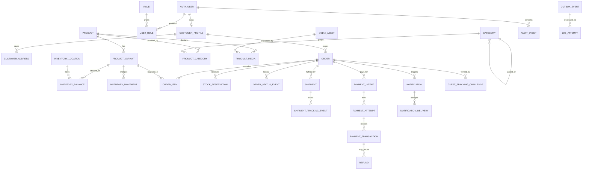

# FLC Decor — Production PostgreSQL Database Specification & Codex Implementation Prompt

**Status:** Approved architectural direction; NOT an assertion of implemented features.  
**Inventory model:** READY-STOCK-ONLY.  
**Launch payment scope:** COD, Easypaisa, JazzCash, debit/credit cards (actual gateway activation subject to merchant approval).  
**Sources of truth for existing scope:** `FINAL_AUDIT_REPORT.md`, `FLC_Decor_Codex_Audit_Remediation_Prompt.md`, `FLC_Decor_Codex_Checkout_Payments_Requirements.md`, and existing repository schema/migrations.  
**Priority:** This document governs **database-first** work. Do not attempt to implement every UI or external integration in this phase.

## 0. Codex operating instructions

You are the senior PostgreSQL/data engineer responsible for designing and implementing the production database foundation for FLC Decor, a Pakistan-based laser-cut décor e-commerce business. **Inspect the repository before writing migrations.** The audit reports Next.js 15.5.28, Prisma schema/migration, and in-memory demo checkout; verify against the current files rather than assuming these versions remain current. Preserve the existing working storefront and safe fail-closed production checkout.

1. Read all referenced documents and existing `prisma/schema.prisma`, migration history, domain models, route handlers, demo-store, tests, environment templates, and architectural decisions.
2. Produce `docs/database/EXISTING_SCHEMA_AUDIT.md`: inventory of current tables/columns/constraints; mapping from proposed models to existing models; safe migration plan; data-preservation plan; contradictions with PRD/SRS and owner decisions.
3. Implement in small reviewed migrations; **do not reset, drop, truncate, or rewrite existing data** without explicit owner approval and a tested restore point. Never use `prisma db push` as the production migration strategy.
4. Use PostgreSQL as the transactional source of truth. Supabase is the preferred managed provider, not a mandate to couple business data to proprietary APIs. Verify current Prisma, Supabase, connection-pooling, and Cloudflare Workers compatibility before committing to a driver/runtime.
5. Write database integration tests against actual PostgreSQL, not only mocks or SQLite. If Docker daemon, credentials, gateway sandbox, or production resources are unavailable, report **BLOCKED/NOT VERIFIED** rather than pretending success.
6. Do not enable live checkout until the separate full production release gates pass. Database phase completion is not equivalent to production launch approval.
7. Never invent tax rates, shipping rates, COD limits, cancellation windows, refund policy, notification consent, or provider credentials. Keep unapproved capabilities disabled or fail closed.
8. Report progress after each phase with commands, exit codes, migration names, test output, evidence, and unresolved risks.

## 1. Non-negotiable business behavior

- **Ready stock only:** a purchasable variant has physically available on-hand quantity. No backorders, preorders, negative available stock, or made-to-order workflow. Custom design requests remain a separate WhatsApp inquiry; no stock commitment or order is created from a message.
- A product has one primary category, optional additional category associations, and a maximum two-level category tree. Variants may represent sizes/colors; stock and prices belong to the **specific variant**.
- Guest checkout and account checkout both work. Guest order requires email and phone. Account order links to a customer identity, but order records retain immutable contact and delivery snapshots.
- Delivery: country fixed/validated to Pakistan at launch; email, phone, first name, last name, street address, city required; apartment/suite and postal code optional. Province/region may be required by courier integration only after approval. Normalize Pakistani phone numbers to a canonical format, preserve user-entered display formatting where needed.
- Registered customers can view only their own orders and historical status timeline; guest customers may view an order **only after verifying** ownership through a short-lived email/SMS challenge and scoped capability. An order number plus email/phone is **not sufficient authorization**.
- Five primary fulfillment stages: PLACED, CONFIRMED, PREPARING, SHIPPED, DELIVERED. Also support explicit CANCELED, RETURN_REQUESTED, RETURNED and EXCEPTION states if approved; maintain a controlled transition graph and immutable history. **Payment status is separate from fulfillment status.**
- Payments: COD, Easypaisa, JazzCash, cards. Online methods require real approved merchant integration; gateway callbacks must be verified, idempotent, and reconciled. Do not store PAN/CVV. COD payment is initially unpaid and only becomes collected when confirmed through an authorized reconciliation event.
- Notifications: order number and confirmation to verified/declared email; optional SMS when approved/configured; delivery failures must not roll back a committed order. Do not claim message delivery before provider acknowledgement.
- Admin portal requires least-privilege roles, mandatory MFA for privileged users, durable activity/audit logs, order/inventory/payment views, and analytics based on accurate financial semantics.

## 2. Data architecture and boundaries

**One PostgreSQL database** with logical domains (schema namespaces optional; use consistently). Product media bytes live in Cloudflare R2; DB holds metadata, ownership, checksums, references, lifecycle. Provider credentials belong in a secrets manager, not DB plaintext. Supabase Auth may manage credentials, sessions, MFA and recovery; in that case store an application profile referencing `auth.users.id` and **do not duplicate password hashes, auth sessions or MFA secrets** in application tables. If existing auth implementation differs, document and approve a single authoritative identity model.

Use UUID primary keys for internal entities (or retain existing stable PKs if migration risk outweighs benefits); unique human-readable order numbers are separate. Use `timestamptz` in UTC; display Asia/Karachi only in UI. Store money as integer minor units (PKR paisa) with currency code, or consistent `numeric(18,2)` with validated rounding; never float. Set NOT NULL/defaults carefully, with check constraints for positive quantities and nonnegative amounts. Use `citext` or normalized email keys; apply appropriate collation/Unicode handling. Sensitive customer information is PII; restrict access and retention.

### 2.1 Conceptual ERD (Mermaid)

**ERD caveat:** This is conceptual, not executable DDL. Guest orders have nullable customer ID and immutable contact/address snapshots. A variant may be stocked in one location initially; multi-location is future-compatible. Order items must never depend on live product fields for historical totals.

## 3. Detailed logical table specification

These are **logical entities**, not an instruction to duplicate existing Prisma models. Codex must merge with existing schema and record final actual table/column names in the data dictionary. Fields marked `*` are critical; add FK, unique and check constraints listed below. Include `created_at` and appropriate `updated_at` on mutable tables. For immutable ledgers/events, use `occurred_at`/`created_at` and prohibit mutation except controlled correction events.

### A. Identity, customer, admin, privacy

| Table | Essential fields / purpose |
|---|---|
| `customer_profiles` | `id*`, `auth_user_id UNIQUE NULL`, display name, normalized email, normalized phone, status, timestamps; guest contacts should not automatically become accounts |
| `customer_addresses` | `id*`, `customer_id*`, label, recipient names, address1, address2, city, region nullable, postal nullable, country=PK, phone, is_default; customer-scoped |
| `roles` | `id*`, unique role code (`OWNER`, `ADMIN`, `CATALOG_MANAGER`, `FULFILLMENT`, `SUPPORT`, `ANALYST`); permissions should be explicit |
| `permissions` / `role_permissions` | unique permission code, role/permission composite unique; omit if existing policy system adequately models them |
| `user_roles` | `auth_user_id*`, `role_id*`, granted_by, granted_at, revoked_at; no self-escalation; role assignment audited |
| `customer_consents` | purpose, consent version, channel, granted/revoked timestamps, evidence reference; transactional vs marketing distinction |
| `security_events` | actor, event type, target, result, IP hash/limited metadata, timestamp; redacted, retention controlled |
| `guest_tracking_challenges` | `order_id*`, channel, destination hash, challenge hash, expires_at, consumed_at, attempts, request metadata; no plaintext OTP |
| `guest_tracking_capabilities` | hashed random token, `order_id*`, scope, expires_at, revoked_at, used_at; short-lived and minimally scoped |

**Authentication boundary:** If using Supabase Auth, reference its `auth.users` IDs; do not create an independent `users` password store. Password reset, login, TOTP and session revocation belong to the selected auth provider/service, with application authorization enforced at every API and database boundary.

### B. Catalog and media

| Table | Essential fields / purpose |
|---|---|
| `categories` | `id*`, `parent_id NULL FK categories`, name, unique slug (define scope), status, display order; maximum depth 2; reject cycles |
| `products` | `id*`, unique slug, title, description, primary_category_id FK, status (`DRAFT`,`ACTIVE`,`ARCHIVED`), featured, published_at, SEO metadata |
| `product_categories` | product/category PK composite, additional category associations; primary category must be valid and consistent |
| `product_variants` | `id*`, `product_id*`, unique SKU, attributes (size/color or validated typed attributes), unit price, currency=PKR, status, weight/dimensions nullable, created_at |
| `media_assets` | `id*`, storage key unique, MIME, bytes, width, height, checksum, processing status, owner, retention/orphan metadata; R2 objects external |
| `product_media` | product_id, media_id, sort_order, alt text, is_primary; unique ordered placement; references protect shared media |
| `product_price_history` | variant_id, previous/new price, effective_at, actor, reason; optional but recommended for audited price edits |

Enforce two-level categories with a database trigger or transactional stored procedure (a simple CHECK cannot inspect parent rows); ensure concurrent reparenting cannot create depth > 2 or cycles. Archive products instead of cascading deletion into order history. Catalog queries must filter to active/published variants and stock appropriately.

### C. Ready-stock inventory

| Table | Essential fields / purpose |
|---|---|
| `inventory_locations` | id, code unique, name, active; seed one physical location initially |
| `inventory_balances` | variant_id + location_id unique, `on_hand >= 0`, `reserved >= 0`, `reserved <= on_hand`, version/update timestamp; **available = on_hand - reserved** |
| `inventory_movements` | immutable id, variant/location, delta_on_hand, delta_reserved, movement type, reference type/id, actor, reason, occurred_at; ledger and balance must reconcile |
| `stock_reservations` | id, order_id, variant_id, location_id, quantity>0, state (`ACTIVE`,`COMMITTED`,`RELEASED`), timestamps, unique order/variant/location as appropriate |
| `stock_adjustments` | id, variant/location, requested delta, reason, actor, approval metadata, posted movement id; corrections audited |

**Physical model:** On placing an order, reserve stock (`reserved += qty`) atomically. On shipment/fulfillment policy approval, commit reservation (`on_hand -= qty; reserved -= qty`) in one transaction. On permitted cancellation before commit, release reservation (`reserved -= qty`) once. Returns increase on-hand **only after physical receipt and inspection**, never automatically on refund. COD unpaid reservation expiry/confirmation rules are owner decisions; do not invent a timeout. Block checkout if available stock insufficient. Never calculate authoritative stock from `localStorage` or process-global Maps.

### D. Carts, orders, fulfillment and history

| Table | Essential fields / purpose |
|---|---|
| `carts` | id, customer_id nullable, hashed guest session reference nullable, currency, status, expires_at; no raw session token |
| `cart_items` | cart_id, variant_id, qty>0, unique cart+variant; prices are informational only |
| `orders` | id, unique public order_number, customer_id nullable, email/phone snapshot, currency, subtotal/shipping/tax/discount/grand_total minor units, fulfillment_status, payment_status, source, placed_at, updated_at; order number allocation collision-safe |
| `order_items` | id, order_id, variant_id nullable/reference, SKU/title/variant attributes/price snapshots, quantity>0, line subtotal, discounts/tax snapshot; historical integrity |
| `order_addresses` | order_id unique, recipient first/last, phone, address1, address2, city, region nullable, postal nullable, country; immutable snapshot |
| `order_status_events` | id, order_id, from_status, to_status, actor_id nullable, actor_type, reason, occurred_at, correlation/idempotency key; append-only |
| `order_notes` | id, order_id, author, visibility (`INTERNAL`,`CUSTOMER`), body, created_at; internal notes never exposed to guests |
| `shipments` | id, order_id, courier, tracking_number, service, shipping charge snapshot, shipped_at, delivered_at, state; may support partial shipments later |
| `shipment_items` | shipment_id, order_item_id, quantity; avoid exceeding ordered quantity across shipments |
| `shipment_tracking_events` | shipment_id, external_event_id unique within provider, status, location summary, event time, ingested_at; preserve raw provider references safely |
| `shipping_zones` / `shipping_rates` | zone/city mapping, rate policy version, effective range, amount; do not seed invented production prices |
| `returns` / `return_items` | requested/approved/received/disposition and associated order items; create if approved return workflow requires it |

Order status history is never reconstructed from current status alone. Define valid transition matrix, including cancellation and exception flows, and guard it transactionally. A guest order is not automatically linked to a new account merely because emails match: require verified ownership/claim flow.

### E. Payments, reconciliation and refunds

| Table | Essential fields / purpose |
|---|---|
| `payment_intents` | id, order_id, method (`COD`,`EASYPAISA`,`JAZZCASH`,`CARD`), provider, amount/currency, state, provider_reference nullable, expiry, idempotency reference |
| `payment_attempts` | id, intent_id, provider_request_id unique where applicable, initiated_at, response state/code, safe redacted metadata |
| `payment_transactions` | id, attempt_id, provider_transaction_id unique scoped to provider, event type (`AUTHORIZED`,`CAPTURED`,`FAILED`,`COD_COLLECTED`, etc.), amount, currency, occurred_at; append-only |
| `payment_webhook_events` | provider, external_event_id unique per provider, signature_verified, received_at, processed_at, payload digest, processing result; safe bounded retention of sanitized payload |
| `refunds` | id, order_id, transaction_id, amount, reason, state, provider_ref, requested/processed timestamps, actor; sum of successful refunds cannot exceed captured/collected funds |
| `payment_reconciliations` | id, provider, period, expected/settled totals, discrepancies, reconciliation status, actor; support COD remittance separately |

Use payment adapter interface; provider credentials outside DB. No gateway can be declared operational without real merchant approval, verified callback handling and sandbox/approved end-to-end evidence. Handle asynchronous payment success, delayed webhook, duplicate events, out-of-order events, gateway timeout and reconciliation. Online checkout order may be `PENDING_PAYMENT` with time-limited stock reservation **only if expiry policy is approved**; payment capture must not silently create overselling. No payment-status change based solely on client redirect. Use hosted payment pages/tokenization; never store card PAN/CVV.

### F. Notifications, reliable jobs, administration and analytics

| Table | Essential fields / purpose |
|---|---|
| `notification_templates` | event key, channel (`EMAIL`,`SMS`), locale, version, template reference, active; no provider secrets |
| `notifications` | id, order_id nullable, recipient reference, event key, channel, dedupe key unique, state, created_at; avoid storing unnecessary PII |
| `notification_deliveries` | notification_id, provider, attempt number, provider_message_id, accepted/delivered/failed status, error code, timestamps; do not confuse accepted with delivered |
| `outbox_events` | id, aggregate_type/id, event_type, payload version, sanitized payload, state, available_at, attempts, created_at; written in SAME transaction as business event |
| `job_attempts` | outbox_event_id, worker, attempt, started/finished, result, error category; safe retries/backoff and dead-letter state |
| `idempotency_keys` | scope (customer/guest/provider), key hash, request hash, result reference, state, expiry, created_at; unique(scope,key_hash), conflict on different payload |
| `audit_events` | id, actor, action, entity_type/id, before/after **redacted** structured diffs, request/correlation id, occurred_at; append-only, access restricted |
| `system_settings` | approved non-secret configuration, version, changed_by, changed_at; secrets excluded |
| `analytics_events` | event type, anonymous/consented identity where permitted, order/product refs, event timestamp, minimal metadata; retention limits |
| `daily_sales_summary` | day, currency, order counts, gross ordered, collected, refunded, net collected, COD outstanding; computed from canonical records |
| `daily_product_summary` | day, variant_id, units ordered/shipped/returned, gross/net amounts; derived |
| `inventory_snapshots` | snapshot_at, variant/location, on_hand/reserved/available; derived for historical trends |

Reporting tables are **derived**, never a second source of truth. For small data volumes, start with indexed SQL views; materialize or incrementally update summaries only when measured query performance justifies it. Define timezone/day-boundary for Pakistan dashboards. For gross/net accounting distinguish placed order value, authorized/captured online payments, COD collected, refunds and shipping/taxes. Never equate placed order value with revenue collected.

## 4. Referential integrity, checks, and index strategy

- Every FK explicitly states ON DELETE behavior; prefer `RESTRICT` for historical financial records and `SET NULL` only where snapshots preserve required history. Never cascade-delete orders/payment ledger/audit history.
- Unique: product slug; SKU; order number; customer/auth user mapping; inventory (variant,location); cart (cart,variant); gateway (provider,event_id); provider transaction reference; outbox dedupe and idempotency (scope,key).
- Checks: nonnegative amounts; quantity > 0; `reserved <= on_hand`; valid country/currency; allowed state values; expiry after creation; optional fields have bounded lengths; refund totals enforced transactionally (cross-row invariants cannot be CHECK constraints).
- Use explicit case-insensitive email normalization and phone canonicalization; index hashes of verified tracking destinations if needed, but never expose contact data through lookup APIs.
- Suggested indexes (validate with EXPLAIN ANALYZE): `orders(customer_id, placed_at DESC, id DESC)`, `orders(fulfillment_status, placed_at DESC)`, `orders(payment_status, placed_at DESC)`, `order_status_events(order_id, occurred_at, id)`, `inventory_movements(variant_id, occurred_at DESC)`, `product_variants(product_id, status)`, `products(status, featured, published_at DESC, id)`, `notifications(state, created_at)`, `outbox_events(state, available_at)`, `payment_webhook_events(provider, external_event_id)`, `audit_events(actor_id, occurred_at DESC)`, `shipments(order_id)`. Add partial indexes for active rows where appropriate.
- Pagination: stable keyset/cursor for admin orders, logs and customer order history; stable tie-breaker IDs. Product search/filter must match size/color/stock on the **same variant**. Use PostgreSQL full-text/trigram only as justified by real search requirements.
- Avoid indexing every column, unbounded JSONB, EAV for core attributes, or premature partitioning. Maintain index review and retention plans.

## 5. Required atomic transaction designs

### TX-01 Place ready-stock COD order

1. Validate authenticated/guest identity, normalized contact, delivery fields, request schema, cart and approved shipping/tax policy. Compute canonical price/totals on server.
2. Obtain/create idempotency record using a unique scope+key. Same key+same payload returns original committed result; same key+different payload returns 409; in-flight/unknown commit resolves by durable lookup.
3. Begin PostgreSQL transaction. Lock or conditionally update inventory rows in deterministic variant ID order to avoid deadlocks. Ensure `on_hand - reserved >= qty` for every requested variant.
4. Create order, immutable order items/address snapshots, active stock reservations, balance updates, inventory ledger, initial order-status event, COD payment intent (unpaid), audit event, and notification outbox events in **one atomic commit**.
5. Commit; only then acknowledge order. If any step fails, rollback all changes. If commit result is unknown, resolve by durable idempotency record before retrying.
6. External email/SMS calls run **after commit** from outbox worker; delivery failure cannot erase order.

### TX-02 Online payment order

Use the same durable reservation/order foundation, but state must distinguish `PENDING_PAYMENT` from `PAID`. Gateway creation occurs outside a long-lived DB transaction with a durable intent and safe idempotent reconciliation. Define reservation expiration and late-payment handling **only after owner approval**. Verified provider webhook writes unique webhook event, payment transaction, order payment-state change, audit event and notification outbox atomically. Replayed callbacks must have no additional stock or money effect. Provider success after reservation expiry requires an explicit refund/manual-resolution path; never oversell.

### TX-03 Admin stock adjustment

Authenticated authorized actor with MFA, reason and reference; lock balance, validate no negative on_hand or `reserved > on_hand`, update balance, append immutable movement, append audit event; all or nothing. Reject changing stock by directly editing a product's stock field.

### TX-04 Cancel / ship / deliver / return

Validate allowed state transition and actor. For cancellation before reservation commit: release reservation once and record movement. For shipment: commit reservation once, decrease on_hand and reserved, create shipment and status event. Delivery updates fulfillment status and courier evidence; COD collected remains separate and requires verified reconciliation. Returns restock only after actual receipt/inspection. Write outbox notification and audit in same transaction.

### TX-05 Payment/refund reconciliation

Verify signed provider event or authenticated operator reconciliation. Enforce provider event uniqueness, exact amounts/currency, state-machine transitions and non-overrefund. Write append-only payment records, derived status, audit and outbox in one transaction. Never mark paid from client-side callback alone.

### TX-06 Guest tracking challenge

For `order_number + email/phone`, return identical public response regardless of match. Apply abuse controls. If matched, send expiring single-use challenge through outbox; store verifier hash, not OTP. After correct verification, issue short-lived random capability scoped to that order; store token hash; redact private notes and unrelated records. Rate-limit and revoke/expire tokens. Account order history requires authenticated ownership and authorization on each query.

## 6. Authorization, privacy, and operational controls

- Select one auth authority. Supabase Auth preferred if compatible; enforce admin MFA and role checks on **every** admin endpoint and data path. Guest and customer endpoints never use a broadly privileged service key in browser.
- Document RLS policy decisions: if direct Supabase client access is used, enable/test RLS on exposed tables; if only trusted backend accesses PostgreSQL, enforce backend authorization and use least-privileged DB roles. No direct public read of `orders`, `payments`, `audit_events`, or contact details.
- Create separate DB roles/credentials for application, migrations, reporting and background worker where feasible; no superuser credentials in runtime.
- Encrypt in transit, use managed encryption at rest, secure secret storage, rotated credentials, sanitized logs. Document sensitive-column access and deletion/retention rules (owner approval required).
- No raw payment credentials, card data, OTPs, full email/SMS content or unnecessary full addresses in audit/event payloads.
- Rate limits, fraud checks, external gateway signature validation and MFA are application/edge responsibilities backed by DB state; a database schema alone does not implement these features.
- Migrations are additive/backfill/constraint-validate/cleanup; use staging rehearsal, backups, and lock-time assessment for large tables. Separate pooled runtime and direct migration connections per provider guidance.
- Backups: configure managed PITR/daily backups or encrypted offsite dumps based on chosen plan; independently back up object metadata and verify R2 recovery. Define owner-approved RPO/RTO, restore drills, retention and encryption/key recovery. No assertion of HA/failover until actually tested on chosen provider.

## 7. Admin analytics and operational queries

Design read-only views/query modules for: total orders by stage; daily/weekly/monthly placed value; collected online payments; COD outstanding and reconciled; refunds and net collected; average order value (clearly defined); best-selling variants/categories; inventory on-hand/reserved/available; low-stock thresholds; abandoned checkout only if event collection consent/policy permits; new/returning customers; guest vs account order share; gateway attempt/success rates; notification delivery failures; shipping delivery time; admin activity. Each metric must have a documented SQL definition, timestamp convention, filtering, null handling, and reconciliation test against raw rows. Implement summary refresh/rebuild tests to prove aggregates reconcile with canonical transactions.

## 8. Integration tests and verified acceptance criteria

Use ephemeral or isolated **real PostgreSQL** database with reproducible migrations and deterministic fixtures. Implement at minimum:

**Schema & migration**
- [ ] Clean DB applies every migration and `prisma validate` / generate succeed.
- [ ] Migration from existing schema/data succeeds without loss; rollback/forward-fix strategy documented.
- [ ] FK, unique, nonnegative, currency, depth-2 category, cycle and status constraints reject invalid writes.
- [ ] Archiving products preserves existing order snapshots.

**Inventory & concurrency**
- [ ] Two concurrent purchases for last one unit: exactly one succeeds; one controlled out-of-stock response; stock never negative.
- [ ] Multi-line checkout with one unavailable line: no order, reservation, ledger, idempotency completion, or outbox partial write.
- [ ] Duplicate line items aggregate correctly at variant level.
- [ ] 10–100 concurrent reservation attempts do not oversell; deadlock handling bounded and tested.
- [ ] Cancel/ship/retry transitions apply stock exactly once; invalid transitions rejected.
- [ ] Reconcile balances with movement ledger and active reservations.
- [ ] Server restart and separate application instances retain same orders, stock and idempotency results.

**Orders & privacy**
- [ ] Guest order persists with email/phone/address snapshot and no account.
- [ ] Account orders appear only to owner, paginated with stable ordering.
- [ ] User A cannot read user B order by guessing IDs or order number.
- [ ] Unverified guest lookup never reveals existence; wrong/expired/replayed OTP denied; scoped token cannot open another order.
- [ ] Admin endpoints require authorization and mandatory MFA; audit captures actor and change.

**Payments & notifications**
- [ ] COD order is not marked paid on placement; collection event is distinct.
- [ ] Gateway webhook with valid signature processes once; duplicate/invalid/out-of-order webhook has no duplicate financial effect.
- [ ] Mismatched amount/currency and over-refund attempts are rejected.
- [ ] Gateway timeout/late success leaves recoverable explicit state; no silent oversell.
- [ ] Notification outbox exists after order commit; simulated email/SMS failure retries without duplicating orders.
- [ ] Provider message state distinguishes queued/accepted/delivered/failed.

**Analytics & operations**
- [ ] Sales/payment/stock dashboard figures reconcile with raw fixture data including canceled, refunded and unpaid COD orders.
- [ ] EXPLAIN ANALYZE reviewed for core product search, order history, admin list and analytics queries at representative synthetic volumes; record actual timings, no invented p95.
- [ ] Encrypted backup restored to separate environment; migration/restore recovery evidence recorded.
- [ ] CI runs migration/integration tests against PostgreSQL; if no GitHub remote yet, prepare workflow files but mark remote execution unverified.

**Mandatory proof:** attach commands, exit status, test output, migration SQL, DB constraint inspection, query plans, and evidence for restart/concurrency/restore. `npm run lint`, `npm run typecheck`, `npm test`, `npm run build` are baseline checks, **not substitutes** for database integration tests. No fabricated screenshots or timings.

## 9. Implementation phases and deliverables

**Phase DB-0 — Audit & decisions**: Inspect existing Prisma schema and audit; create gap mapping, logical ERD, data dictionary draft, migration plan, open owner decisions. **Gate:** no destructive change without approval.

**Phase DB-1 — Foundation**: Configure PostgreSQL dev/staging connection patterns, migration tooling, database roles, environment examples, test DB harness. **Gate:** fresh migrations apply and constraints tested on real PostgreSQL.

**Phase DB-2 — Identity/catalog/inventory**: Implement authoritative models, category-depth protection, variant stock, inventory ledger and stock transaction API. **Gate:** stock concurrency and adjustment tests pass.

**Phase DB-3 — Orders/checkout/history**: Implement guest/account order snapshots, durable idempotency, transactional reservations, status history, account authorization and verified tracking DB primitives. **Gate:** restart, two-instance and last-item tests pass; live checkout still blocked until all launch gates.

**Phase DB-4 — Payments/notifications**: Payment intents/attempts/transactions/webhook dedupe, refunds, outbox and delivery attempts; adapter interfaces and sandbox tests. **Gate:** no simulated gateway success presented as production readiness; blocked provider integrations explicitly listed.

**Phase DB-5 — Admin/audit/analytics**: Permission data model, immutable admin activity, reporting queries/views, aggregate reconciliation and keyset pagination. **Gate:** least-privilege authorization and financial correctness tests pass.

**Phase DB-6 — Hardening & operations**: Backups/restore drill, connection pooling, migration rehearsal, EXPLAIN review, retention, CI, security review, data recovery. **Gate:** evidence recorded; unknowns marked BLOCKED.

Required files:
- `docs/database/EXISTING_SCHEMA_AUDIT.md`
- `docs/database/ERD.md` (Mermaid and relationship cardinalities)
- `docs/database/DATA_DICTIONARY.md` (actual table/column definitions, types, defaults, nullability, FK/delete policies)
- `docs/database/TRANSACTION_DESIGN.md` (SQL-level locking, isolation, retry and idempotency semantics)
- `docs/database/SECURITY_AND_RLS.md`
- `docs/database/ANALYTICS_DEFINITIONS.md`
- `docs/database/MIGRATION_AND_BACKUP_RUNBOOK.md`
- `docs/database/DB_TEST_EVIDENCE.md`
- `docs/database/OPEN_BUSINESS_DECISIONS.md`
- `docs/database/DB_IMPLEMENTATION_TRACKER.md` with each item `NOT_STARTED`, `IN_PROGRESS`, `VERIFIED`, or `BLOCKED`, and exact evidence links
- Reviewed Prisma schema, SQL migrations, seeds, DB integration tests, environment template, and CI configuration.

## 10. Decisions that require owner approval (do not assume)

1. **Shipping:** nationwide vs selected cities; city/zone pricing, free-shipping threshold, courier, shipment splitting.
2. **Tax:** applicable registration/tax treatment, tax-included/excluded pricing, invoice requirements (consult qualified local adviser).
3. **COD:** allowed order amount, customer verification policy, who confirms, when stock is reserved/committed, collection/remittance reconciliation.
4. **Online gateways:** approved Easypaisa/JazzCash/card merchant account, gateway/provider, settlement/refund methods, webhook support, test credentials; provider-specific feasibility.
5. **Pending payment reservations:** expiration duration, abandoned payment cleanup, late-success handling and refund policy.
6. **Returns/cancellations:** permitted windows, shipped-order cancellation, restocking after inspection, refund fees and partial refunds.
7. **Notifications:** email and SMS provider, verified sender identity, whether SMS is mandatory at launch, OTP channel fallback, transactional vs marketing consent.
8. **Account linkage:** whether and how guests can securely claim previous orders; never auto-attach based on matching email.
9. **Inventory:** initial warehouse/location, SKU rules, physical stock counts, low-stock thresholds, oversell prevention during admin corrections.
10. **Data governance:** customer retention/deletion policy, audit retention, privacy notice, backup RPO/RTO, residency and service budgets.
11. **Hosting:** chosen Supabase plan, region, backup/PITR entitlement, Cloudflare/Prisma runtime compatibility and production secrets.
12. **Analytics:** definition of gross sales, net collections, shipping revenue, discounts, returns and COD reconciliation for owner dashboard.

If undecided, implement the extensible data structures, document a safe fail-closed behavior, and stop before enabling affected production flows.

## 11. Codex starting command

> Read `FINAL_AUDIT_REPORT.md`, `FLC_Decor_Codex_Audit_Remediation_Prompt.md`, `FLC_Decor_Codex_Checkout_Payments_Requirements.md`, and this database specification. The owner has selected **READY-STOCK-ONLY** inventory and requires guest/account checkout and COD, Easypaisa, JazzCash and card payment support. **Start with DB-0: inspect the actual repository and existing Prisma schema, map every existing model, identify conflicts, propose migration-safe schema and transaction design, and write the audit/ERD/data dictionary/open-decisions documents.** Do not implement speculative business policies, do not drop existing data, and do not enable live checkout. Then implement DB-1 through DB-6 incrementally with real PostgreSQL integration tests, evidence and an updated tracker. Ask for approval before destructive changes, external paid services or business-policy decisions. Do not call the database production-ready until every required verification gate passes.

---

**Definition of done:** Schema + migrations + transactions + authorization boundaries + real PostgreSQL concurrency tests + recovery evidence + documented unresolved external dependencies. The entire storefront is **not** production-ready merely because this database milestone passes.
