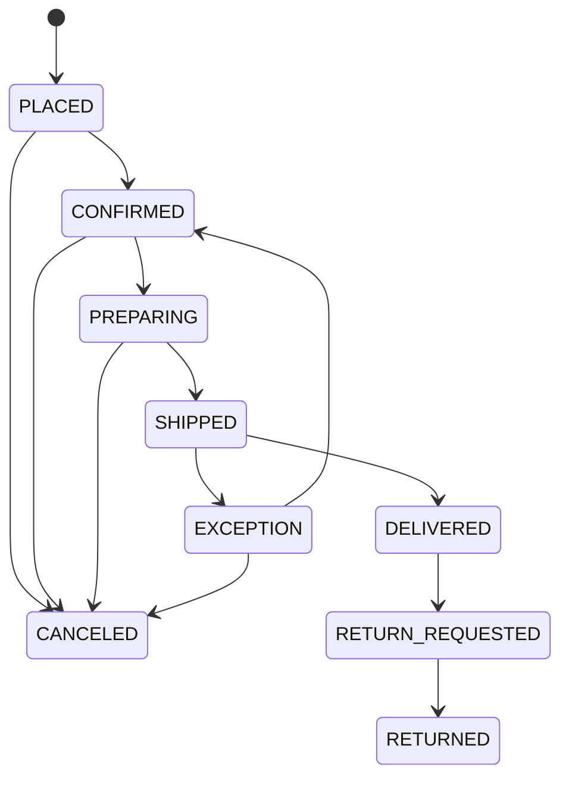

# Order state machine (test-safe implementation; production disabled)

Schema separates fulfillment from payment. Existing legacy `Order.status` remains for compatibility. Migration `0004` maps only unambiguous legacy fulfillment states and preserves each old status as an event; old payment state remains NULL because the legacy schema does not prove collection.

`lib/order-lifecycle.ts` implements this graph only for non-production
`COD_DEMO` orders behind server-side `orders.transition`, MFA and same-origin
checks. It is not a live business policy. Repeated same-target transitions are
idempotent; cancellation releases active reservations and dispatch commits
reserved stock exactly once in a serializable transaction with audit,
notification and outbox records. Return restocking is intentionally not
implemented before physical-inspection policy exists. Production transitions
fail closed.

The graph still requires owner/operations/legal review, including shipped
cancellation, COD acceptance/collection, return eligibility, exception
handling, required evidence and inventory effects. Payment state changes remain
independent and require verified provider events or authorized COD
reconciliation.

Inventory invariants: an ACTIVE reservation may be released once on test-safe
cancellation; shipment commits a reservation once; returns never replenish
on-hand automatically. No expiry is configured.
