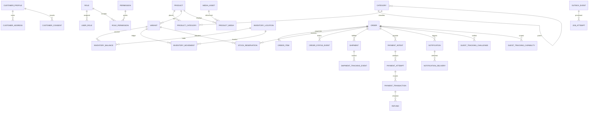

# Production database ERD

This ERD is the proposed additive PostgreSQL foundation represented by Prisma and migration `0004_production_database_foundation`. Authentication is an external authority selected later; `CustomerProfile.authUserId` is an external UUID, not an FK to a proprietary schema.

Orders and ledger/event records are retained; current catalog entities may be archived. The legacy `User` relations are retained for compatibility and are not the chosen production-auth integration.
